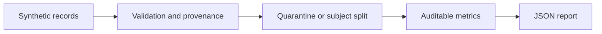

> **Proprietary - All Rights Reserved.** Licensed to Sandeep Grover. No reuse, copying, modification, or distribution without prior written permission. See LICENSE.

# Auditable analytics pilots

Three small, runnable **synthetic** demonstrations: sports-feed validation,
physiological-signal quality checks and subject-level splitting, and reconciled
dashboard metrics. These are newly prepared examples, not client deliveries.
No private data, credentials, external services, LLM calls, or medical claims.



## Run

Python 3.11 or newer:

```bash
python -m venv .venv
source .venv/bin/activate
pip install -r requirements.txt
python main.py
python -m pytest -q
```

The NHL example quarantines all duplicate identities and blocks publishing a
batch with errors. It is not a betting strategy or live API/Supabase integration.
Production work needs transactional promotion, idempotent writes, monitored
upstream contracts and a tested recovery path.

The signal example uses explicitly illustrative thresholds on generated sine
waves. It does not train a foundation model, remove motion artefacts, estimate
clinical biomarkers, or establish real-world PPG/BCG performance. Real signal
work needs device-specific metadata, motion references, labelled quality data,
subject/session separation and validation before interpreting biomarkers.

The dashboard example reconciles paid totals, refuses mixed currencies and
duplicate IDs, and reports missing statuses. Its narrative is deterministic;
it must not be described as AI-generated. Any later LLM summarizer needs
source-grounded numeric checks and a deterministic fallback.

## Point-in-time review example

`python temporal_review.py` demonstrates a synthetic webpage observation that was
corrected after a prediction date. The historical feature uses only observations
available by that date; a retrospective corrected view is reported separately.
`test_temporal_review.py` checks future leakage, late corrections, timestamp and
identity boundaries, duplicate records, unknown entities and conflicting values.
No client data or historical client outcomes appear in this example. It does not
fit a model, establish causality, implement deletion semantics or connect to GCP.
